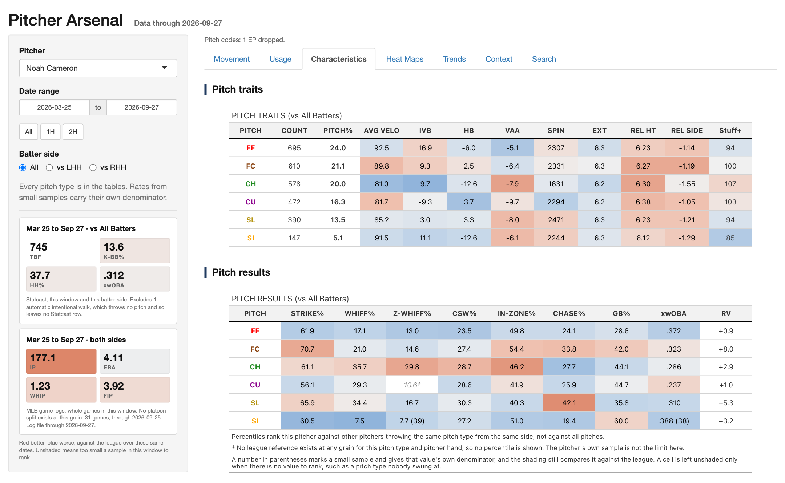
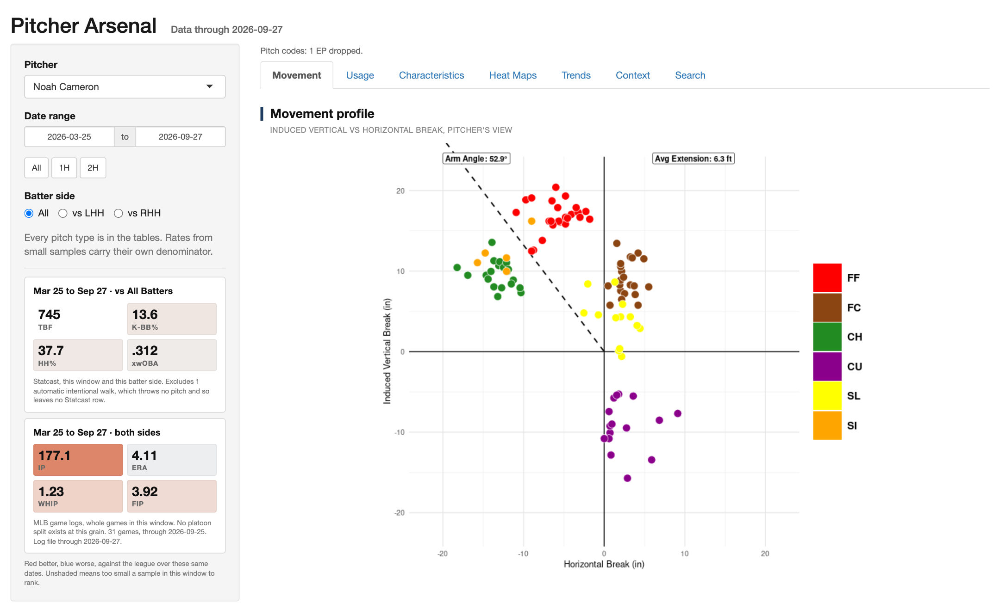

# Pitcher Arsenal

**Live app: [jonathanmerlin.shinyapps.io/pitcher-arsenal](https://jonathanmerlin.shinyapps.io/pitcher-arsenal/)** (it sleeps when idle and can take up to a minute to wake)

A Shiny app that shows any pitcher's movement, usage, pitch characteristics and heat maps within major league context, filtered by date range or batter handedness. Its search feature finds pitchers by specific criteria, such as fastballs above 90 mph.



Built with R, Shiny, ggplot2 and gt, on the complete 2026 regular season: 714,111 Statcast pitches and MLB StatsAPI game logs. During the season the data refreshed every morning through GitHub Actions and redeployed to shinyapps.io.



## What's in the app

| Tab | Shows |
|---|---|
| Movement | Induced vertical and horizontal break for each pitch, with arm angle and extension. |
| Usage | Usage by batter side and by count, pitch mix by outing, and a times-through-the-order toggle. |
| Characteristics | Pitch traits (velocity, movement, VAA, spin, release, Stuff+) and pitch results (whiff%, chase%, xwOBA, run value), each shaded against the league for that pitch type and pitcher hand. |
| Heat Maps | Location density by pitch type, before two strikes and with two strikes. |
| Trends | One pitch game by game, flagging any metric whose last five games fall outside his normal game-to-game range. |
| Context | League percentiles for one pitch, and how unusual the pitcher's release point is for his arm slot and height. |
| Search | Every pitcher matching a pitch shape, e.g. right-handed four-seams at 95+ mph with 18+ inches of ride. |

The sidebar results panel shows K-BB%, hard-hit rate and xwOBA from Statcast, and IP, ERA, WHIP and FIP from MLB game logs, for the selected window.

## How it works

**League context is built pitcher first.** Every percentile ranks a pitcher's pitch against other pitchers' averages for the same pitch type and pitcher hand, never against a pool of pitches, so a 3,000-pitch starter doesn't outweigh thirty relievers. The reference is precomputed as 101 quantiles per cell, so a lookup costs nothing at runtime.

**Small samples are labeled, not hidden.** Each metric has a floor on its own denominator (50 swings for whiff%, 50 plate appearances for xwOBA), set by an offline resampling study of how fast each stabilizes. A value under its floor is still shaded and carries its sample size in parentheses.

**Definitions match Savant.** On the final 2026 data, whiff%, chase%, zone% and hard-hit% per pitcher are within 0.1 points of Savant's leaderboard on average, and whiff% per pitcher and pitch type is within 0.05 points of Savant's pitch-arsenal leaderboard across 1,256 pitch types (`scripts/verify_savant.R`, `scripts/verify_arsenal_savant.R`).

**The data pipeline runs itself.** During the season a GitHub Actions workflow pulled new Savant data each morning, rebuilt the league reference and game logs, and redeployed the app only when the data or code changed.

More detail:

- [Methodology](docs/methodology.md): league context, sample floors, metric definitions, VAA, pitch codes, Stuff+.
- [Data pipeline](docs/pipeline.md): the data chain, data files, deploy and scheduling.
- [Validation](docs/validation.md): the test suite and the checks against Savant and MLB.
- [Changelog](CHANGELOG.md)

## Run it locally

```bash
git clone https://github.com/jbmerlin3/statcast-arsenal-app.git
cd statcast-arsenal-app
Rscript -e 'renv::restore()'
```

`renv.lock` pins the packages the app and tests use, against R 4.5.2 (rsconnect, needed only to deploy, is installed separately). The data files under `data/` are not in the repo (about 45 MB). Build them from the 2026 season store, which is published as a release asset:

```bash
gh release download season-store --pattern statcast_clean_2026.rds --dir store
STATCAST_STORE=store/statcast_clean_2026.rds SKIP_DEPLOY=1 Rscript scripts/update_data.R
Rscript -e 'shiny::runApp(".", launch.browser = TRUE)'
```

The chain also calls the MLB StatsAPI for game logs; `SKIP_DEPLOY=1` stops it before deploying.

Run the tests from the repo root:

```bash
Rscript tests/run_all.R
```

## Repository layout

```
app.R          UI and server; logic lives in R/
R/             data loading, features, league context, tables, plots, search, results
scripts/       the data chain, deploy, verification against Savant, local monitoring
tests/         test files and fixtures; run_all.R runs them
lookups/       small tracked tables: listed heights, position players, Stuff+ grades
docs/          methodology, pipeline, validation, screenshots
.github/       the refresh-and-deploy workflow
```
